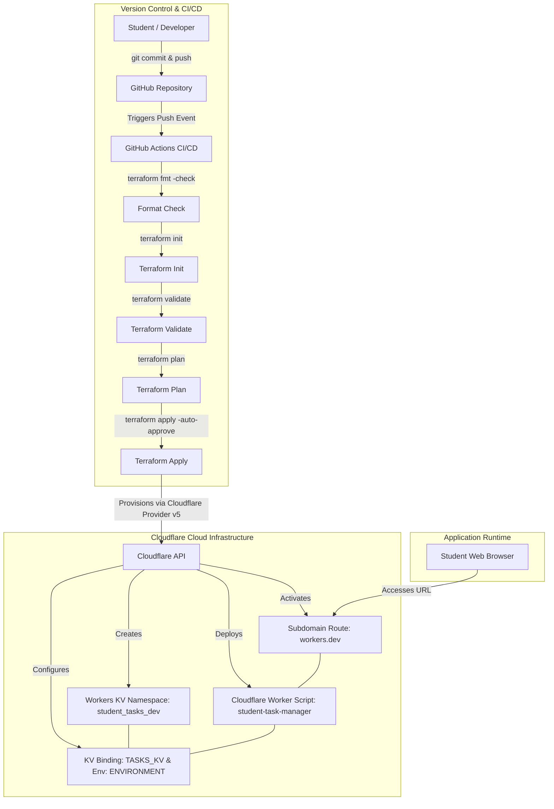

# Automated Deployment of a Serverless Student Task Management Application Using Terraform-Based Infrastructure as Code (IaC)

[](https://github.com/vedikapande44-spec/student-task-manager-iac/actions/workflows/deploy.yml)
[](https://www.terraform.io/)
[](https://workers.cloudflare.com/)
[](https://developers.cloudflare.com/kv/)
[](LICENSE)

> **Live Application URL**: [https://student-task-manager.vedikapande44.workers.dev](https://student-task-manager.vedikapande44.workers.dev)

---

## 1. Project Overview

Modern cloud applications require multiple infrastructure components—compute services, persistent storage, environment variables, network routing, and deployment pipelines. Traditionally, these resources were provisioned manually via graphical cloud web consoles. Manual configuration introduces severe disadvantages:
- Configuration drift and human error
- Inability to reproduce environments identically across teams
- No version control or audit trail for infrastructure
- Time-consuming disaster recovery and environment recreation

**Infrastructure as Code (IaC)** resolves these challenges by defining all infrastructure in declarative configuration files. This project implements and deploys a complete serverless **Student Task Management Application ("TaskNest")** using **Terraform** on **Cloudflare Workers** and **Workers KV**, fully automated with a **GitHub Actions CI/CD pipeline**.

---

## 2. System Architecture

### High-Level Architecture Diagram
```
                     +---------------------------------------+
                     |             END USER                  |
                     |     (Web Browser / Mobile Client)     |
                     +---------------------------------------+
                                         |
                                         | HTTPS (GET / style / script / API)
                                         v
                     +---------------------------------------+
                     |        Cloudflare Global Edge         |
                     |       (200+ Cities CDN Network)       |
                     +---------------------------------------+
                                         |
                                         v
                     +---------------------------------------+
                     |           Cloudflare Worker           |
                     |        ("student-task-manager")       |
                     |  - Serves Single-Page Web UI          |
                     |  - Implements RESTful CRUD API        |
                     +---------------------------------------+
                                         |
                                         | KV Binding ("TASKS_KV")
                                         v
                     +---------------------------------------+
                     |         Cloudflare Workers KV         |
                     |        ("student_tasks_dev")          |
                     |  - Global low-latency Key-Value store |
                     |  - Key: "task:T101" -> Value: JSON    |
                     |  - Key: "meta:counter" -> Value: Seq  |
                     +---------------------------------------+
```

### Infrastructure Provisioning & CI/CD Lifecycle Diagram


---

## 3. Project Directory Structure

```
student-task-manager-iac/
├── .github/
│   └── workflows/
│       └── deploy.yml            # Automated CI/CD pipeline for Terraform
├── application/
│   ├── index.html                # TaskNest Single Page UI
│   ├── script.js                 # Frontend SPA logic, router, and animations
│   ├── style.css                 # Modern CSS styles with dark aesthetic
│   └── worker.js                 # Cloudflare Worker code (REST API & KV logic)
├── terraform/
│   ├── environments/
│   │   ├── dev.tfvars            # Development environment variable definitions
│   │   └── prod.tfvars           # Production environment variable definitions
│   ├── main.tf                   # Terraform resources (KV, Worker, Subdomain)
│   ├── outputs.tf                # Terraform output variables
│   ├── providers.tf              # Cloudflare provider specification
│   ├── terraform.tfvars.example  # Example variable definitions for contributors
│   └── variables.tf              # Terraform input variable declarations
├── screenshots/
│   └── README.md                 # 16-point visual verification checklist
├── scripts/
│   ├── test_crud.ps1             # PowerShell script for automated CRUD testing
│   └── verify_api.py             # Python script for REST API validation
├── .gitignore                    # Prevents credentials, states, and keys from Git
├── PROJECT_REPORT.md             # Complete 10-chapter academic mini project report
├── VIVA_PREPARATION.md           # Basic, intermediate & advanced viva Q&A
└── README.md                     # Comprehensive project documentation
```

---

## 4. Infrastructure as Code (Terraform) Breakdown

### Cloudflare Provider Configuration (`terraform/providers.tf`)
Uses the official `cloudflare/cloudflare` provider (v5.x). No sensitive API keys or tokens are hard-coded in the configuration:
```hcl
terraform {
  required_version = ">= 1.5.0"

  required_providers {
    cloudflare = {
      source  = "cloudflare/cloudflare"
      version = "~> 5.0"
    }
  }
}

provider "cloudflare" {}
```

### Resource Declarations (`terraform/main.tf`)
1. **Frontend Asset Bundling (`locals`)**: Injects HTML, CSS, and JS into the worker bundle dynamically during `terraform plan` / `apply`.
2. **Workers KV Namespace (`cloudflare_workers_kv_namespace.tasks`)**: Provisions globally distributed key-value storage for student task records.
3. **Cloudflare Worker Script (`cloudflare_workers_script.task_manager`)**: Compiles and deploys the serverless runtime with KV namespace binding (`TASKS_KV`) and plain text environment binding (`ENVIRONMENT`).
4. **Subdomain Route (`cloudflare_workers_script_subdomain.task_manager`)**: Enables public access under `https://<worker_name>.<subdomain>.workers.dev`.

### Input Variables (`terraform/variables.tf`)
| Variable Name | Type | Default | Description |
|---|---|---|---|
| `account_id` | `string` | *(Required)* | Cloudflare Account ID |
| `worker_name` | `string` | `"student-task-manager"` | Name of the serverless worker |
| `kv_namespace_name` | `string` | `"student_tasks"` | Prefix for the KV namespace |
| `environment` | `string` | `"dev"` | Target deployment environment |
| `workers_subdomain` | `string` | `"vedikapande44"` | Account workers.dev subdomain |

### Outputs (`terraform/outputs.tf`)
- `worker_name`: The name of the deployed Worker script.
- `kv_namespace_id`: The unique 32-character hexadecimal identifier of the KV namespace.
- `application_url`: The public HTTPS endpoint to access the live web application.

---

## 5. REST API Specification

| HTTP Method | Endpoint | Description | Request Body | Response Code | Sample Output |
|---|---|---|---|---|---|
| `GET` | `/` | Web Application HTML | *None* | `200 OK` | HTML document |
| `GET` | `/api/tasks` | List all student tasks | *None* | `200 OK` | `[{"id":"T101","title":"..."}, ...]` |
| `POST` | `/api/tasks` | Create a new task | `{"title":"...","priority":"High","status":"Pending"}` | `201 Created` | `{"id":"T101", ...}` |
| `GET` | `/api/tasks/:id` | Fetch task by ID | *None* | `200 OK` / `404 Not Found` | `{"id":"T101", ...}` |
| `PUT` | `/api/tasks/:id` | Update task details / status | `{"status":"Completed"}` | `200 OK` / `400 Bad Request` | `{"id":"T101", "status":"Completed", ...}` |
| `DELETE` | `/api/tasks/:id` | Delete task from KV | *None* | `200 OK` / `404 Not Found` | `{"message":"task deleted","id":"T101"}` |

---

## 6. Local Setup and Deployment Guide

### Prerequisites
- [Git](https://git-scm.com/) installed
- [Terraform CLI](https://developer.hashicorp.com/terraform/downloads) (>= 1.5.0) installed
- Cloudflare Account with an API Token having **Workers Scripts: Edit** and **Workers KV: Edit** permissions

### Step 1: Clone Repository
```powershell
git clone https://github.com/vedikapande44-spec/student-task-manager-iac.git
cd student-task-manager-iac
```

### Step 2: Configure Authentication & Variables
Set your Cloudflare API token as an environment variable in your terminal session:
```powershell
# In PowerShell:
$env:CLOUDFLARE_API_TOKEN = "your-cloudflare-api-token-here"

# In Linux / macOS Bash:
export CLOUDFLARE_API_TOKEN="your-cloudflare-api-token-here"
```

Create `terraform/terraform.tfvars`:
```hcl
account_id        = "your-cloudflare-account-id"
workers_subdomain = "your-subdomain"
```

### Step 3: Run Terraform Lifecycle
```powershell
cd terraform

# 1. Initialize Terraform & download Cloudflare provider
terraform init

# 2. Check code format compliance
terraform fmt -check

# 3. Validate syntax and resource schema
terraform validate

# 4. Review planned cloud resource creations
terraform plan

# 5. Provision infrastructure to Cloudflare
terraform apply -auto-approve
```

---

## 7. CI/CD with GitHub Actions

The repository includes a fully automated GitHub Actions workflow in `.github/workflows/deploy.yml`:
1. **Trigger**: Push or pull request to `main` or `master` branches, or manual trigger (`workflow_dispatch`).
2. **Automated Steps**:
   - `actions/checkout@v4`: Clones repository.
   - `hashicorp/setup-terraform@v3`: Sets up Terraform CLI.
   - `terraform fmt -check -recursive`: Enforces code formatting.
   - `terraform init`: Initializes remote plugins and backend.
   - `terraform validate`: Verifies syntax and schema correctness.
   - `terraform plan`: Generates execution plan.
   - `terraform apply`: Applies infrastructure changes automatically on push to `main`.

### Required GitHub Secrets
In your GitHub Repository, navigate to **Settings > Secrets and variables > Actions** and add:
- `CLOUDFLARE_API_TOKEN`: Cloudflare API Token.
- `CLOUDFLARE_ACCOUNT_ID`: Cloudflare Account ID.
- `CLOUDFLARE_WORKERS_SUBDOMAIN`: Account subdomain (e.g. `vedikapande44`).

---

## 8. Mandatory IaC Demonstration (Evaluation Walkthrough)

To verify the core principles of Infrastructure as Code:

### A. Automated CRUD Verification
Run the automated test suite against the deployed application:
```powershell
# Using Python:
python scripts/verify_api.py

# Or using PowerShell:
.\scripts\test_crud.ps1
```

### B. Infrastructure Modification Experiment
1. In `terraform/variables.tf` or `terraform/environments/dev.tfvars`, modify the environment variable:
   ```hcl
   environment = "staging"
   ```
2. Run `terraform plan`. Observe that Terraform detects the exact drift and proposes an in-place modification of the KV title and Worker binding.
3. Run `terraform apply` to apply the update seamlessly without manual cloud console intervention.

### C. Disaster Recovery / Destroy & Recreate Experiment
1. Run `terraform destroy -auto-approve`.
2. Verify in the Cloudflare Dashboard that the Worker and KV namespace are completely removed.
3. Re-run `terraform apply -auto-approve`.
4. Observe that the entire serverless infrastructure is recreated from code in under 15 seconds.

---

## 9. Deliverables & Documentation Index

- [Complete Mini Project Report (10 Chapters + 20 Academic Questions)](PROJECT_REPORT.md)
- [Viva Voce & Technical Interview Guide](VIVA_PREPARATION.md)
- [Screenshots Submission Checklist](screenshots/README.md)
- [GitHub Actions CI/CD Workflow](.github/workflows/deploy.yml)

---

## 10. License
This project is open-source under the [MIT License](LICENSE).
